<!-- The banner, covers and doodle stickers live in assets/. The doodles are my own drawings. -->

  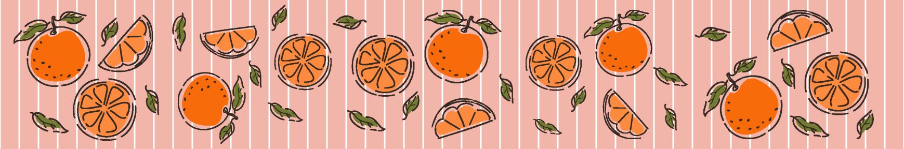

<h1 align="center">Chloe Robinson</h1>

  <b>UX/UI designer and frontend developer</b> · Pretoria, South Africa 
  I like designing pretty things and then making them work.

  
  
  
  

  <a href="#about-me">About</a> ·
  <a href="#flagship-project-sonata">Sonata</a> ·
  <a href="#development-projects">Development</a> ·
  <a href="#uxui-case-studies">UX/UI</a> ·
  <a href="#live-sites">Live sites</a> ·
  <a href="#toolkit">Toolkit</a> ·
  <a href="#contact">Contact</a>

  &nbsp;
  &nbsp;
  &nbsp;
  &nbsp;
  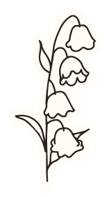&nbsp;
  

## About me

I'm a UX/UI designer and frontend developer in my final year at Open Window. I chose design because I loved IT but didn't want to lose the creative spark, so now I get both. I enjoy the research side of a project, but what I really love is turning that research into working code that looks beautiful and actually works.

In a team I'll lead when the work needs it; on Koru I was the project manager. Otherwise you'll find me on research and documentation, or working alongside the backend to bring the frontend to life. My coding style includes tea, a hunched back and my cat trying to sit on my keyboard.

Away from the screen, I've been riding since I was five, and my horse Gedenk has been my partner since I was thirteen. I also love reading, birdwatching (it's where Envol came from), RPGs and indie games, and I'll rewatch *Kiki's Delivery Service*, *How to Train Your Dragon* or *Star Wars* any day. Every doodle in this README is mine.

 

## Flagship project: Sonata

  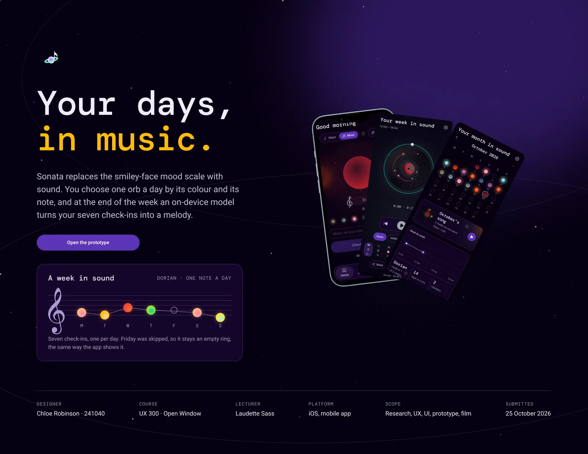

  
  
  
  
  

**A mood check-in you can hear. Final-year DV300 project, built solo from first sketch to release.**

Most mood trackers ask you to put your day into a word. In Sonata you pick one of 14 glowing orbs (seven notes, in major or minor) by how it sounds. At the end of the week, an AI on your phone, trained on Bach's chorales, writes those seven notes into a song, and every month becomes a record. There's no account, no trackers, and not one emotion word in the interface.

<table>
  <tr>
    <td align="center"> A check-in</td>
    <td align="center"> The week's song</td>
    <td align="center"> The month</td>
  </tr>
</table>

**Technologies:** React Native 0.86 (Expo SDK 57), TypeScript, Expo Router, NativeWind, React Native Skia, Reanimated, expo-audio, Firebase (anonymous auth, Cloud Firestore, security rules), EAS Build and EAS Update, Jest, Figma

**Highlights:**
- Trained the composer myself, from scratch in TypeScript: a Markov chain for chords and a small GRU neural network for melody, learned from 382 Bach chorales, with backpropagation, the Adam optimiser and a test that checks every gradient
- Measured it rather than assuming it: on 77 unseen chorales, chord perplexity fell from 5.77 (hand-written rules) to 4.60, melody perplexity from 4.71 to 2.43, and the network's top guess for the next note is right 72% of the time
- The AI runs entirely on the phone, so nobody's daily moods are ever sent to a third party
- Private by design: every check-in is sealed with AES-256-GCM on the phone before it's saved, works offline, and syncs to Firestore in the background as ciphertext only
- Drew every orb, glow and night sky in shared Skia canvases, and replaced live synthesis with pre-rendered instrument recordings mixed on the phone, after both lagged and crackled on a mid-range Android
- Accessible beyond sound: Feel notes give every note its own vibration pattern for deaf and hard-of-hearing users
- Grew past the brief with an Oasis (paced breathing, calming sounds, a thought record and South African helplines), a Composer, sheet music export (PDF and MusicXML) and playlists
- 213 automated tests in 28 suites, a problem log of every bug with its cause and fix, and user and lecturer feedback shipped as over-the-air updates the same day

  
  
  
  

  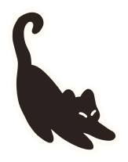

## Development projects

### Koru

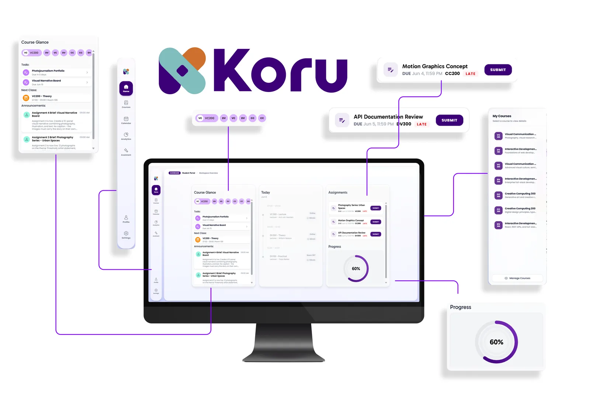

**Full-stack learning management system for a real client brief. Third-year team project; I was the project manager.**

Koru brings courses, scheduling, assessments, analytics and communication into one cross-platform desktop app for students, teachers and administrators, and complies with South Africa's POPIA by design.

**Technologies:** React 19, TypeScript, Vite, Electron, Tailwind CSS, DaisyUI, Framer Motion, Chart.js, ASP.NET Core (C#), Entity Framework Core, PostgreSQL, BCrypt, Swagger

**Highlights:**
- Ran the sprints, kept the backlog prioritised and wrote all of the project documentation
- A native desktop app for Windows and macOS through Electron, wrapping a React and Vite frontend
- A normalised, POPIA-compliant PostgreSQL schema with role-based access for three user types, behind 15 REST API controllers
- 216 automated tests (xUnit.net and FluentAssertions on the backend, Vitest and React Testing Library on the frontend), with 83% backend and about 80% frontend line coverage
- Acted on client and lecturer feedback: a clearer dashboard hierarchy, a 3,500-line component split into focused modules, and per-course due dates

[View the repository](https://github.com/corbyn-jpg/learn-online)

### Envol

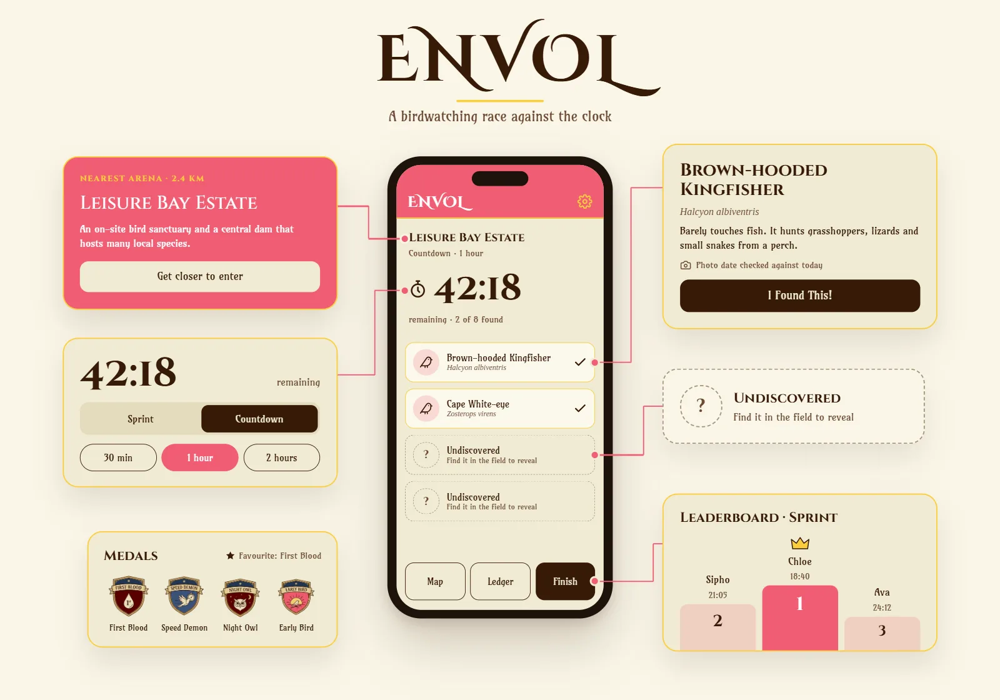

**A location-based birdwatching race for Android. DV300 term project, built solo.**

Players travel to real-world arenas, race to identify the birds found there, and prove each sighting with a timestamped photo.

**Technologies:** React Native 0.81 (Expo SDK 54), TypeScript, Expo Router (typed routes), Firebase (Authentication and Cloud Firestore), react-native-maps, expo-location, expo-image-picker

**Highlights:**
- GPS-gated arenas that only unlock inside a location's radius, using the haversine formula
- Two race modes sharing one clock that derives elapsed time from timestamps, so it stays accurate across navigation and throttling
- Photo verification through EXIF capture times, rejecting screenshots and forwarded images; an AI vision check was costed and prototyped, and this free, offline approach chosen instead
- Eight achievement medals derived from race history rather than stored, and every meaningful permission enforced by Firestore security rules

[View the repository](https://github.com/corbyn-jpg/envol)

### This portfolio

**My own site, [chloerdesigns.co.za](https://www.chloerdesigns.co.za/): a "studio wall" where every project is pinned up like a note, stuck on with my own hand-drawn tape and thumbtacks.**

**Technologies:** React, Vite, Motion, hand-traced SVG drawings

### Earlier projects

| Project | What it is | Built with |
| --- | --- | --- |
| [Poseidon's Notebook](https://github.com/corbyn-jpg/poseidons-notebook) | A full-stack logbook for marine species sightings, with sign-in and full CRUD | React, Node.js, Express, MySQL, JWT |
| [Open Library Explorer](https://github.com/corbyn-jpg/formative-one-openlibrary) | A dashboard that turns Open Library data into charts, trends and author comparisons | React, Chart.js, Axios, CSS Modules |
| [Vinoir](https://github.com/corbyn-jpg/summative-vinoir) | A team-built luxury perfume shop with accounts, a catalogue and a cart | React, Node.js, Express, MongoDB, Material UI |

## UX/UI case studies

<table>
  <tr>
    <td width="33%" valign="top">
      
      <b>Sonata</b> From research to a working app, built around one rule: no emotion words.
    </td>
    <td width="33%" valign="top">
      <a href="https://www.behance.net/gallery/250929689/Ontora-Design-for-accessibility">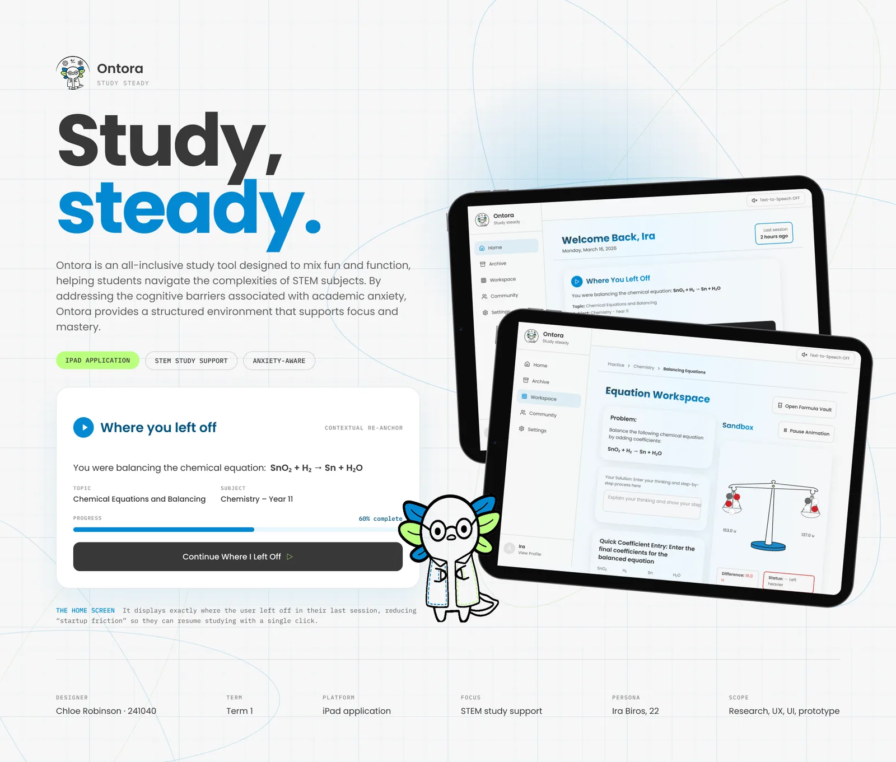</a>
      <b>Ontora</b> Design for accessibility.
    </td>
    <td width="33%" valign="top">
      <a href="https://www.behance.net/gallery/250837171/Waddle-wearable-AI">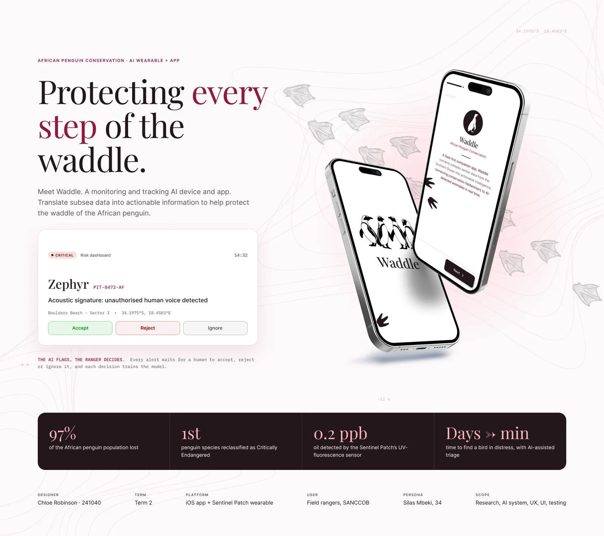</a>
      <b>Waddle</b> A wearable AI.
    </td>
  </tr>
</table>

## Live sites

<table>
  <tr>
    <td width="50%" valign="top">
      <a href="https://www.bilanciaaccounting.co.za/">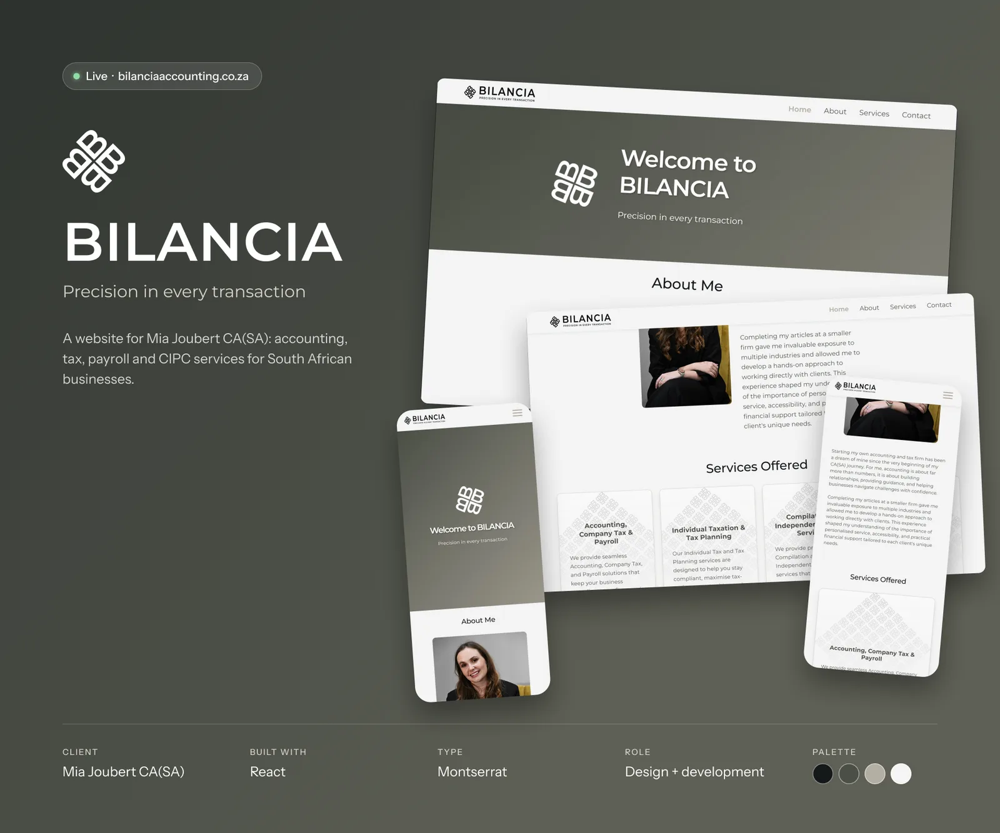</a>
      <b><a href="https://www.bilanciaaccounting.co.za/">Bilancia Accounting</a></b> A live client website, built with React.
    </td>
    <td width="50%" valign="top">
      <a href="https://www.erinrobinsoncounselling.co.za/">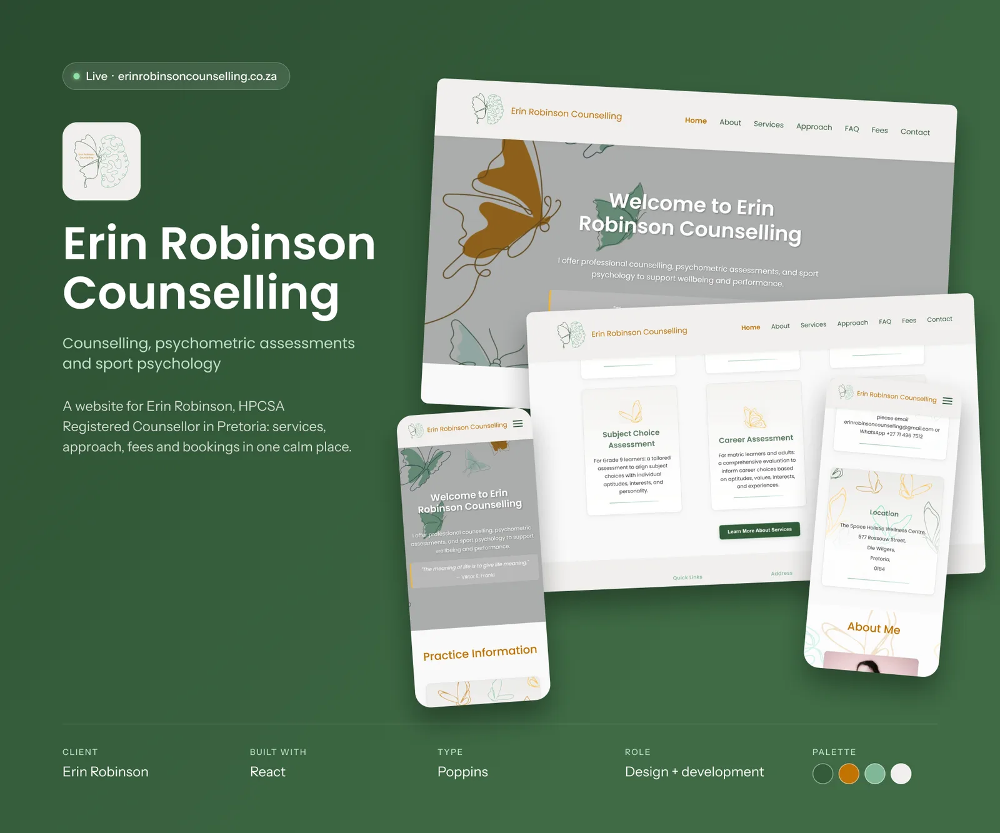</a>
      <b><a href="https://www.erinrobinsoncounselling.co.za/">Erin Robinson Counselling</a></b> A live client website, built with React.
    </td>
  </tr>
</table>

## Toolkit

**Languages** 
     

**Web and desktop** 
        

**Mobile** 
       

**Backend and data** 
        

**AI, audio and video** 
   

**Testing and tools** 
        

**Design** 
      

**What I bring:** user research and testing, wireframes to high-fidelity prototypes, design systems and style tiles, accessible design, full-stack apps from database to UI, privacy and POPIA compliance by design, automated testing, client requirements and feedback, sprint planning and documentation.

 

## Currently learning

- **Motion for mobile:** springs, gestures and GPU-drawn effects with Reanimated and Skia
- **On-device machine learning:** small models that are measurable, explainable and private
- **Testing at scale:** branch coverage, integration tests and automated build checks
- **Cloud deployment:** CI/CD pipelines and scalable infrastructure

  

## GitHub activity

  

## Contact

I'm finishing my degree this year and looking for UX/UI or frontend roles, on-site around Pretoria and Johannesburg or remotely, full-time or freelance.

  
  
  
  

## Off the clock

  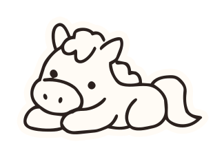&nbsp;
  &nbsp;
  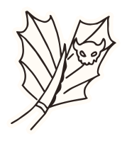&nbsp;
  &nbsp;
  &nbsp;
  &nbsp;
  &nbsp;
  

Riding (with Gedenk, since I was thirteen), fantasy and sci-fi books, RPGs and indie games, birdwatching, and Studio Ghibli on repeat.

> "In the spirit of science, there really is no such thing as a 'failed experiment.' Any test that yields valid data is a valid test." — Adam Savage

  

